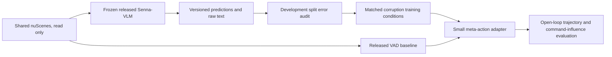

# Empirical Error-Aware Conditioning for Senna-Style VLM-Guided Planning

Team: Parth Panchal and Shloak Aggarwal. Track: VLM-Guided Autonomous Driving.

Can a planner trained with the real error distribution of Senna-VLM remain more
robust to upstream decision errors than a planner trained with ground-truth
meta-actions only or uniformly corrupted actions?

Reproduce the released **Senna-VLM** inference pipeline, cache predictions on
nuScenes, measure speed/path errors, then add a lightweight discrete meta-action
adapter to a released official **VAD** planner (Base or Tiny). The complete
Senna-E2E implementation is unavailable under the supplied project evidence;
this is a **Senna-style VAD reconstruction**, not exact Senna-E2E reproduction.
Senna-2 is the principal SOTA comparison, not a reproduction target.



| Condition | Planner conditioning during training |
|---|---|
| C0 | Released VAD, no action adapter |
| C1 | Ground-truth speed/path actions |
| C2 | Uniform corruption matched to measured actual-change rate |
| C3 | Empirical confusion-aware corruption fitted on development data |

Match C1–C3 data, initialization, trainable parameters, steps, sample order and
augmentation. Start with one seed; three seeds follow only after a measured
pilot. Cached-prediction training and calibrated confidence gating are optional.
Evaluate oracle and real predicted actions, severity-scaled empirical errors,
uniform errors, action/error subsets, and counterfactual command influence.
Report repository-standard planning metrics, valid ADE/FDE, open-loop collision
proxies, runtime, peak memory and GPU-hours. These do not establish real-world
safety. A planner ignoring the action is a failure requiring investigation.

**Status:** HPC infrastructure smoke passed (job 116264, exit 0:0). Official
source revisions and candidate environment recipes are pinned. Model environment
installation/import checks are blocked by compute-node network connectivity
(job 116267 failed before installation); no model weights, prediction caches,
baseline evaluation or planner implementation exist yet. See
[environment setup](docs/environments.md) for the next connectivity diagnostic.

Start with [REPRODUCIBILITY.md](REPRODUCIBILITY.md). See [DATASET.md](DATASET.md),
[HPC inventory](docs/hpc_inventory.md), [experiment log](docs/experiment_log.md),
and [readiness requirements](docs/readiness.md). Literature context is preserved in the
[survey](literature_sota_survey.md) and [novelty audit](novelty_feasibility_audit.md).

Local checks need only Python's standard library and Bash:

```bash
python3 -m unittest discover -s tests -v
bash -n scripts/hpc/*.sh scripts/hpc/*.sbatch scripts/environments/*.sh
```

Private configuration lives in ignored `.env`; YAML examples document the same
variables and are not loaded at runtime. Never commit data, weights, personal
paths, credentials, caches or scheduler logs. Legacy commits contain student IDs;
this change removes them from the current README without rewriting history.
